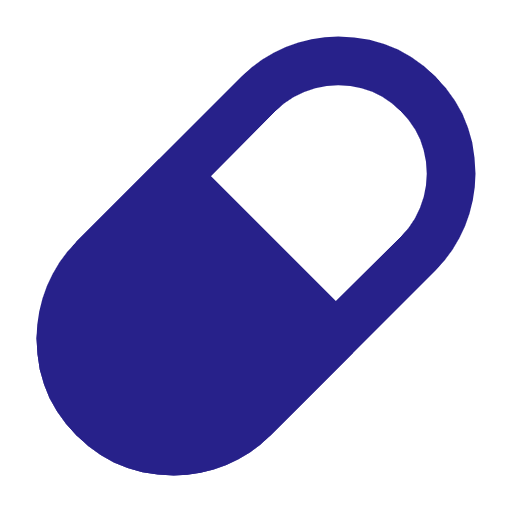

  <picture>
    <source media="(prefers-color-scheme: dark)" srcset="doc/img/logo-oscuro.png">
    
  </picture>

<h1 align="center">PillRemind</h1>

  
  

  Recordatorio de medicación local para Android 8.0 o superior. Sin cuentas, sin
  sincronización y sin nube: los perfiles, medicamentos y tomas se guardan en el móvil.

## Descarga

La aplicación se distribuye como APK desde las
[releases de GitHub](https://github.com/arodriguezvaz/PillRemind/releases/latest).
No está publicada en Google Play.

- Requiere Android 8.0 (API 26) o superior.
- Descarga `PillRemind-x.y.z.apk` y ábrelo. Android pedirá permiso para instalar
  apps de fuentes desconocidas y puede mostrar un aviso de Play Protect.
- Las actualizaciones se avisan desde la propia app y se instalan sobre la versión
  anterior conservando los datos.
- El escaneo de medicamentos usa ML Kit a través de Google Play Services; el resto
  de la app funciona aunque no esté disponible.

**Guía paso a paso, con capturas:**
[Manual de descarga e instalación](doc/docs/manual-instalacion.md)

## Qué hace

- **Perfiles**: medicación separada para varias personas en el mismo móvil.
- **Medicamentos**: dosis, unidad, foto y pauta por días, intervalos o ciclos.
- **Escaneo de medicamentos**: fotografía la caja y el código para leer el CN,
  consultar CIMA y rellenar la ficha. Si CIMA no encuentra el producto, la app
  puede leer el texto de la caja con OCR.
- **Recordatorios**: notificación a la hora de cada toma, con acción para marcarla.
- **Historial y adherencia**: búsqueda y filtros de tomas, resumen de 7, 30 y 90 días.
- **Copia de seguridad local**: exportación e importación con contraseña opcional.

**Guía de uso, con capturas:** [Manual de uso](doc/docs/manual-uso.md)

## Privacidad

Los perfiles, medicamentos, horarios, tomas e imágenes se guardan en una base de
datos Room del dispositivo. La app no tiene cuentas, sincronización ni servidor
propio.

Hay dos conexiones a internet:

- **Actualizaciones**: como máximo una vez al día se consulta un fichero público
  de GitHub Releases. No se envían datos de salud ni identificadores personales.
- **CIMA**: solo cuando escaneas un medicamento y aceptas el diálogo de
  consentimiento. Se envía únicamente el CN a la API pública de la AEMPS; no se
  envían perfiles, medicamentos, tomas, fotos ni identificadores personales. El CN
  no se guarda en la base de datos ni en las copias de seguridad y el resultado se
  descarta al terminar la revisión.

Las fotos se procesan en el dispositivo con ML Kit y no se suben a ningún servidor.
Si rechazas la consulta a CIMA o la red falla, puedes seguir usando el OCR de la
caja o rellenar el formulario a mano.

**Detalle técnico del escaneo:** [OCR, códigos y CIMA](doc/docs/escaneo.md).

## Desarrollo

Android con Kotlin, Jetpack Compose, Hilt, Room y WorkManager. El APK de release se
compila, firma y publica con GitHub Actions.

**Detalles técnicos, compilación y publicación:**
[Guía de desarrollo](doc/docs/desarrollo.md)

## Aviso legal

PillRemind es una herramienta de apoyo para recordar la medicación. No es un
producto sanitario, no emite diagnósticos ni recomendaciones médicas y no sustituye
la consulta con un profesional sanitario.

El escaneo y el OCR son ayudas: pueden leer mal el nombre, la dosis o la forma
farmacéutica. La información de CIMA procede de la AEMPS y se ofrece tal cual, sin
garantía de exactitud o actualización. Revisa siempre los datos antes de guardar y
consulta el prospecto o a tu médico o farmacéutico ante cualquier duda.

El código se distribuye bajo licencia MIT y la aplicación se ofrece «tal cual», sin
garantías de disponibilidad o funcionamiento ininterrumpido.

## Autoría y licencia

Proyecto personal de [Andrés Rodríguez Vázquez](https://github.com/arodriguezvaz),
nacido como proyecto de fin de ciclo DAM y mantenido desde entonces. Se distribuye
bajo licencia MIT; consulta [LICENSE](LICENSE).
