# Manual de descarga e instalación

PillRemind **no está en Google Play**: se distribuye como archivo APK desde las
*releases* de GitHub. Este manual explica cómo descargarla, instalarla y qué avisos
puede mostrar Android por el camino.

El proceso es el mismo en cualquier móvil Android 8.0 o superior, pero **los nombres
de los menús cambian un poco según el fabricante**. Al final tienes una tabla con las
rutas habituales de cada marca.

**Enlace oficial:**
<https://github.com/arodriguezvaz/PillRemind/releases/latest>

> **Importante:** descarga siempre el APK desde ese enlace. No uses copias de otros
> sitios ni archivos reenviados por mensajería: un APK modificado podría acceder a tus
> datos de salud.

## Antes de empezar

- Necesitas **Android 8.0 (API 26) o superior**.
- El APK ocupa unos **16 MB**; deja algo de espacio libre en el móvil.
- No hace falta cuenta ni conexión para usar la app: todos los datos se guardan en el
  móvil. La aplicación usa internet para comprobar si hay actualizaciones y, solo si
  escaneas un medicamento y aceptas el consentimiento, para consultar el CN en CIMA.
  El escaneo necesita Google Play Services; el resto de la app funciona sin conexión.

## Paso 1. Abre la página de la última versión

Entra en el enlace oficial desde el navegador del móvil. Verás la página de la
release con el apartado **Assets** (archivos adjuntos).

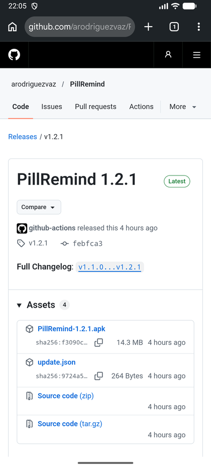

El archivo que hay que descargar es **`PillRemind-X.Y.Z.apk`** (por ejemplo,
`PillRemind-1.2.1.apk`). Los demás archivos (`update.json` y `Source code`) no se
instalan: son parte interna del proyecto.

## Paso 2. Descarga el APK

Toca el nombre del archivo. El navegador preguntará dónde guardarlo.

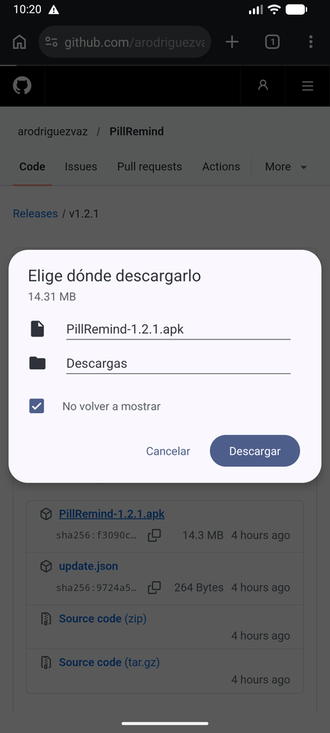

Pulsa **Descargar**. Puedes dejar la carpeta **Descargas** que propone el navegador.

## Paso 3. Aviso del navegador: «Es posible que el archivo sea dañino»

Es muy probable que el navegador muestre un aviso como este:

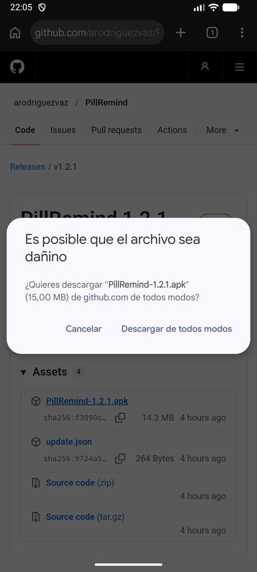

Es **normal en cualquier APK que no venga de Google Play**: el navegador no conoce al
desarrollador y avisa por precaución. Si has descargado el archivo desde el enlace
oficial, pulsa **Descargar de todos modos**.

> Si el aviso te genera dudas, cancela y comprueba que la dirección es exactamente
> `github.com/arodriguezvaz/PillRemind`. En la propia página de la release puedes
> comparar el **SHA-256** del archivo con el que se muestra junto a él.

Cuando termine, aparecerá el aviso **Archivo descargado** con un botón **Abrir**.

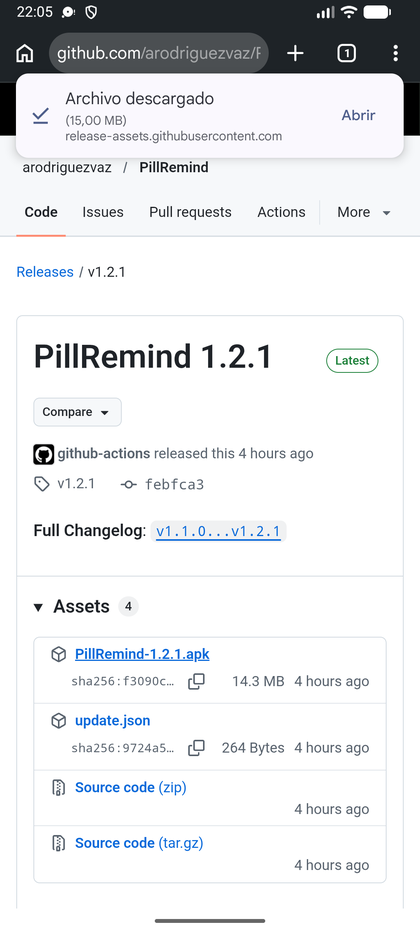

## Paso 4. Abre el archivo descargado

Puedes pulsar **Abrir** en ese aviso o, si lo has cerrado, entrar en el menú de Chrome
→ **Descargas** y tocar el archivo.

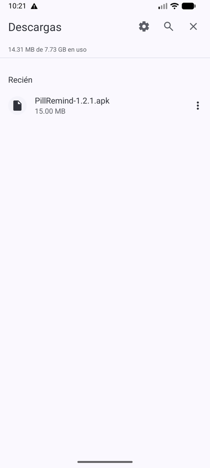

También puedes abrirlo desde la app **Archivos** del móvil, dentro de la carpeta
**Descargas**. El resultado es el mismo.

## Paso 5. Permite instalar apps desconocidas

Android bloquea por defecto la instalación de apps que no vienen de Google Play. La
primera vez que abras un APK, el sistema mostrará este aviso:

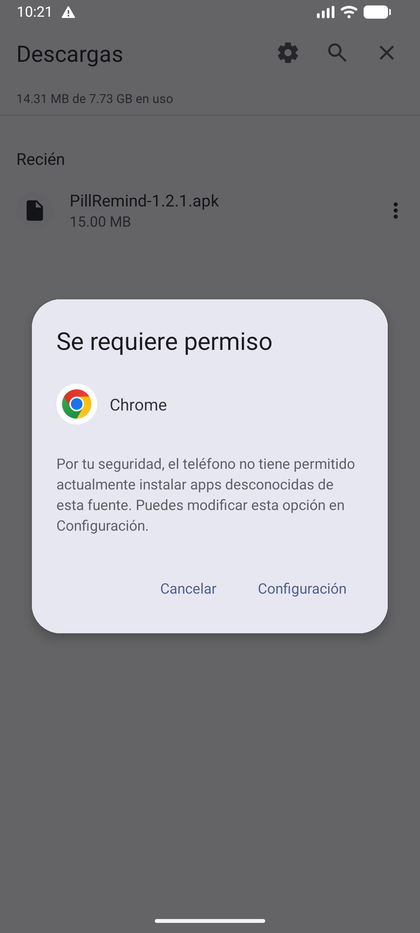

Pulsa **Configuración**. Se abrirá una pantalla para autorizar **solo a esa app**
(Chrome en este ejemplo) como fuente de instalación.

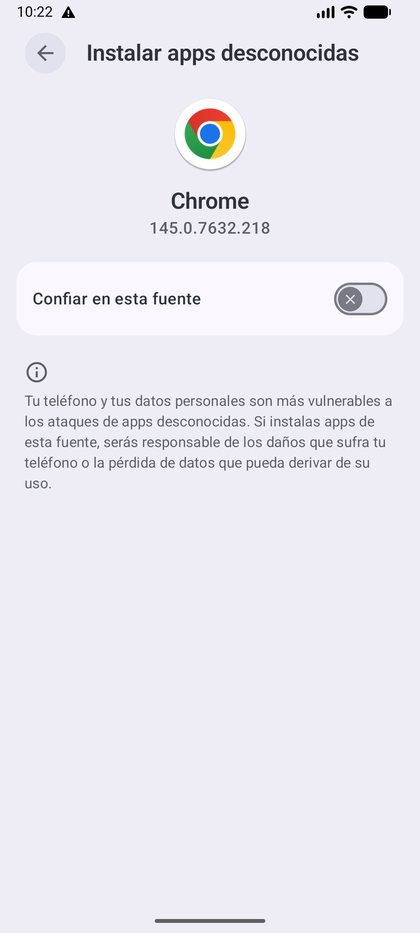

Activa **Confiar en esta fuente** (en otros móviles aparece como *Permitir desde esta
fuente* o *Instalar apps desconocidas*).

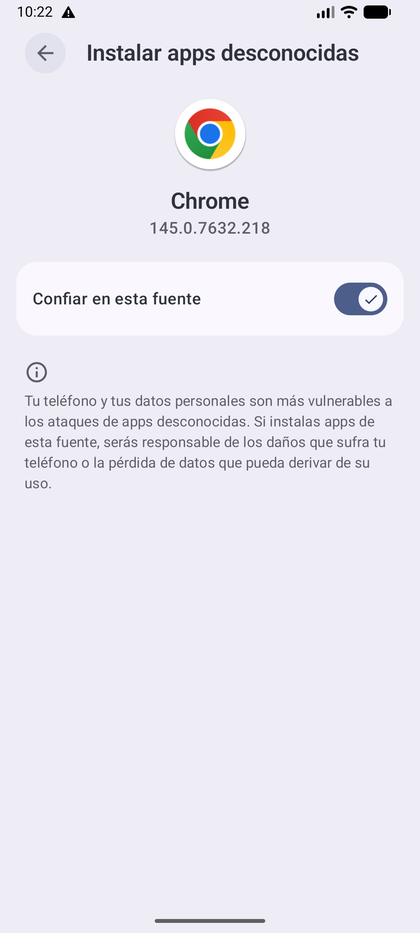

> **¿Qué son las «fuentes desconocidas»?** Android llama así a cualquier app que no
> sea Google Play. No quiere decir que el archivo sea peligroso: quiere decir que el
> sistema no puede comprobarlo por su cuenta. Por eso conviene descargar solo desde el
> enlace oficial y revisar que el archivo se llama `PillRemind-X.Y.Z.apk`.

> Este permiso solo afecta a la app desde la que abres el APK (el navegador o el
> gestor de archivos). No da acceso a tus datos y puedes desactivarlo cuando termines
> desde esa misma pantalla.

## Paso 6. Confirma la instalación

Vuelve atrás y verás la confirmación del instalador de Android:

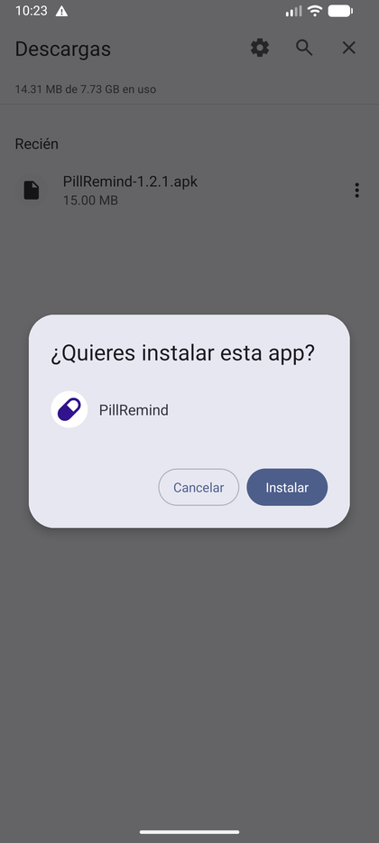

Pulsa **Instalar**.

## Paso 7. Aviso de Google Play Protect

Muchos móviles muestran un aviso de Play Protect porque el desarrollador no está
registrado en Google Play:

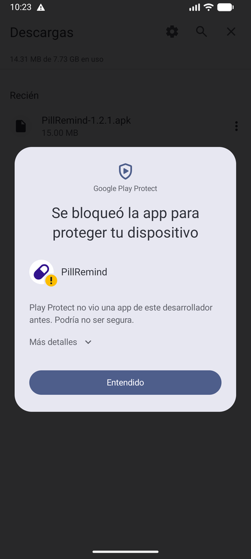

Pulsa **Más detalles** para ver la opción de continuar:

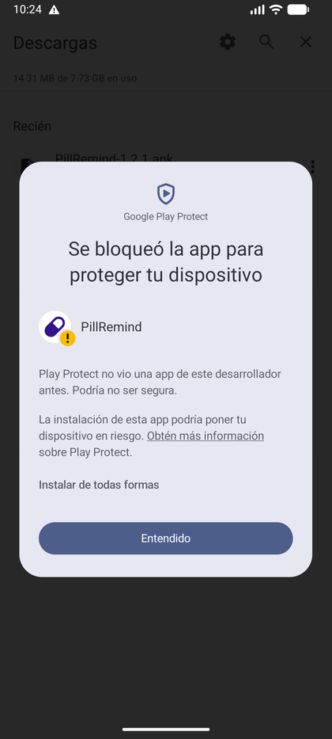

Pulsa **Instalar de todas formas** únicamente si el archivo procede del enlace
oficial.

> Play Protect avisa porque no ha visto antes aplicaciones de este desarrollador, no
> porque haya detectado un virus. En algunos móviles el aviso no aparece; en otros
> puede ser más restrictivo y no ofrecer esta opción.

## Paso 8. La app ya está instalada

Puedes pulsar **Abrir** para iniciarla o **Listo** para volver al inicio. El icono de
PillRemind quedará en el cajón de aplicaciones.

## Paso 9. Primer inicio

La primera vez, PillRemind pide los permisos que necesita para avisarte de las tomas:
**notificaciones** y **alarmas exactas**.

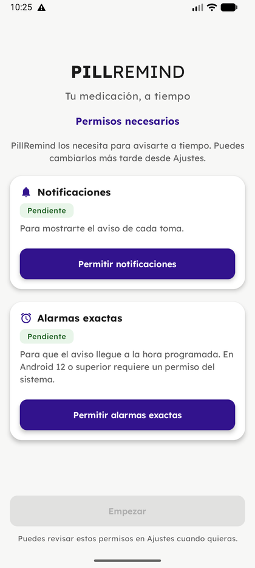

Concede ambos permisos con los botones de la pantalla y pulsa **Empezar**. También
puedes revisarlos más tarde desde los ajustes del móvil.

## Según el dispositivo

El texto y la ruta cambian según la capa de personalización, pero la idea es la misma:
busca en Ajustes la opción de instalar apps desconocidas y elige la app desde la que
abriste el APK.

| Dispositivo | Ruta habitual |
| --- | --- |
| Android puro (Pixel, Motorola, Nokia, emulador) | Ajustes → Aplicaciones → Acceso especial → Instalar apps desconocidas |
| Samsung (One UI) | Ajustes → Seguridad y privacidad → Instalar apps desconocidas |
| Xiaomi, Redmi, POCO (HyperOS/MIUI) | Ajustes → Aplicaciones → Gestionar apps → Permisos → Instalar apps desconocidas |
| OPPO, realme, OnePlus (ColorOS/OxygenOS) | Ajustes → Aplicaciones → Acceso especial → Instalar apps desconocidas |
| Huawei, Honor | Ajustes → Seguridad → Más ajustes de seguridad → Instalar apps externas |

Otros casos que conviene tener en cuenta:

- **Otros navegadores** (Firefox, Samsung Internet…): el permiso se pide para ese
  navegador concreto, no para Chrome.
- **Descarga bloqueada por el navegador**: algunos navegadores no descargan APK por
  defecto. Permite la descarga en sus ajustes o usa Chrome.
- **Gestor de archivos**: si abres el APK desde una app de archivos, el permiso de
  «instalar apps desconocidas» se pide para esa app, no para el navegador.
- **Móvil de empresa, instituto o con control parental**: es posible que la
  instalación esté bloqueada por el administrador y no se pueda saltar.
- **Xiaomi/HyperOS**: si el instalador se cierra solo, revisa que no esté activa la
  «Optimización MIUI» o instala desde el explorador de archivos del sistema.

## Problemas frecuentes

- **No aparece el botón «Instalar»**: vuelve a abrir el APK y revisa que hayas
  concedido el permiso del paso 5 a la app correcta.
- **«App no instalada»**: puede faltar espacio libre o que el archivo se haya
  descargado mal. Bórralo y descárgalo de nuevo desde el enlace oficial.
- **Quiero desactivar el permiso de fuentes desconocidas**: Ajustes → Aplicaciones →
  Acceso especial → Instalar apps desconocidas → elige la app y desactívalo.
- **Voy a instalar una versión anterior**: Android no permite bajar de versión sin
  desinstalar, y al desinstalar se borran los datos. Exporta antes una copia de
  seguridad desde la app.

## Actualizaciones: la app te avisa

**Ya está: no hace falta repetir este manual cada vez.** A partir de ahora, PillRemind
comprueba por su cuenta si hay una versión nueva (como máximo una vez al día) y lo
avisa dentro de la app con un diálogo:

> **Nueva versión disponible** — «La versión X.Y.Z ya está disponible. ¿Quieres
> actualizar ahora?»

Al pulsar **Actualizar ahora** se abre en el navegador la descarga del APK oficial.
El proceso es el mismo que el de este manual y, al instalar sobre la versión anterior,
**se conservan los perfiles, medicamentos, horarios, historial e imágenes**, siempre
que el APK esté firmado con la misma clave.

También puedes comprobar actualizaciones a mano desde **Ajustes → Buscar
actualizaciones**. Si la versión instalada deja de ser compatible, el aviso pasa a ser
obligatorio: la app solo permite actualizar o salir de ella (los recordatorios ya
programados siguen funcionando).

---

*Capturas realizadas en un emulador con Android 17. En un móvil real los colores y los
textos pueden variar ligeramente según el fabricante y la versión del sistema.*
