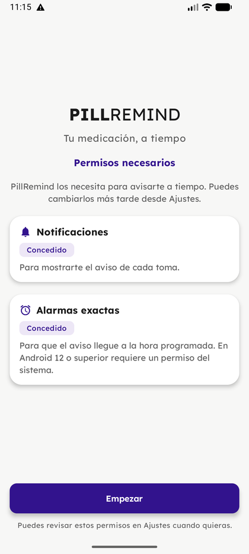
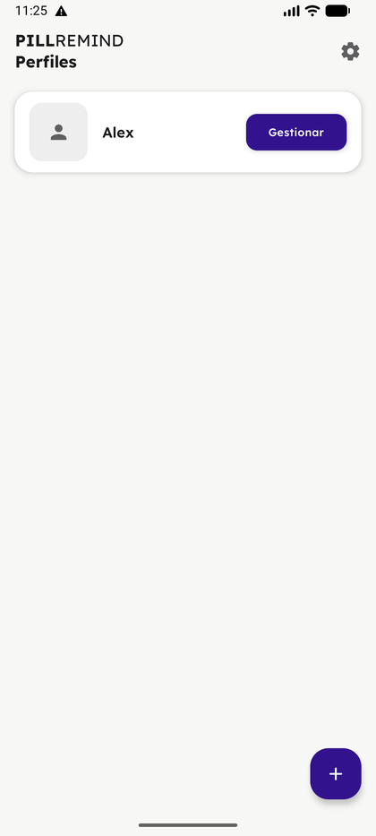
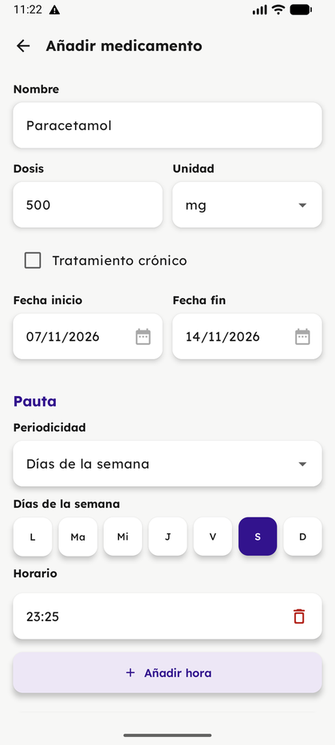
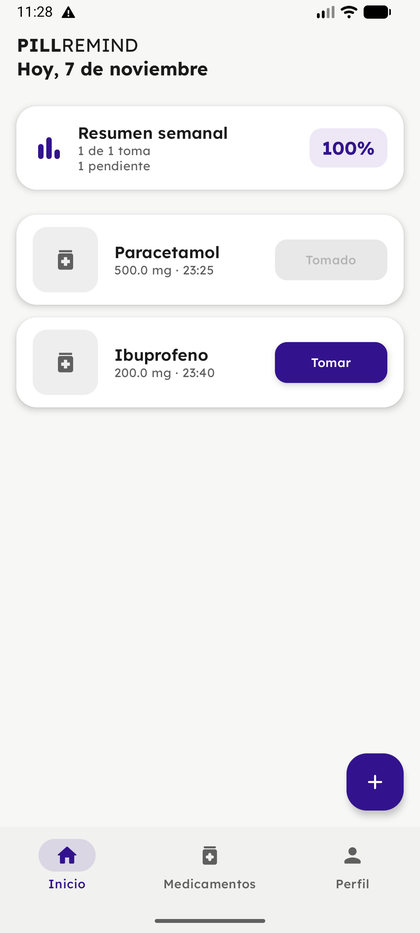
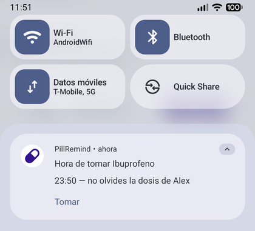
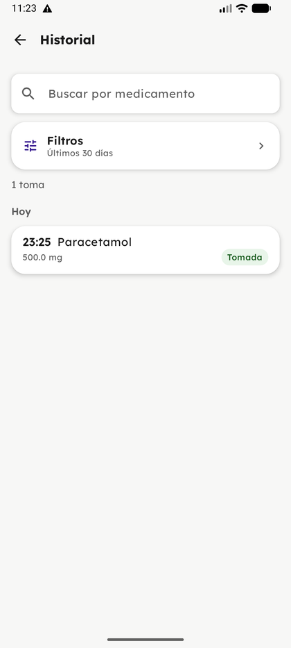
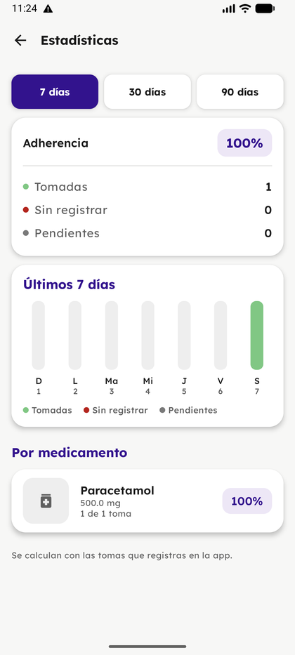
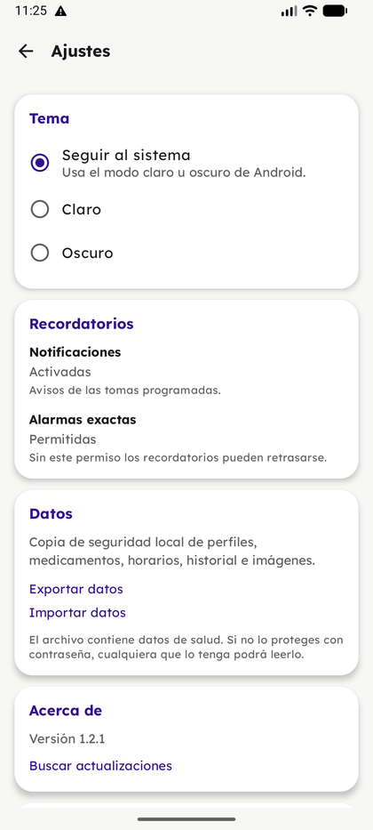

# Manual de uso

Guía rápida de PillRemind. Para instalar la aplicación, consulta el
[manual de descarga e instalación](manual-instalacion.md).

## 1. Primer inicio

La primera vez que abras la app verás la pantalla de permisos. PillRemind necesita:

- **Notificaciones**, para avisarte de cada toma.
- **Alarmas exactas**, para que el aviso llegue a la hora programada.

Concede ambos permisos y pulsa **Empezar**. Puedes cambiarlos más tarde desde los
ajustes del móvil.

## 2. Perfiles

PillRemind abre en la lista de perfiles. Cada perfil guarda sus propios
medicamentos, historial y estadísticas, así que puedes usar la app para ti y para
otra persona sin mezclar datos.

- **Crear un perfil**: pulsa el botón **+**.
- **Entrar en un perfil**: pulsa **Gestionar** en su tarjeta.
- **Cambiar de perfil**: vuelve atrás desde la pantalla principal.

En el perfil puedes añadir datos opcionales (nacimiento, grupo sanguíneo, alergias,
notas y tarjeta sanitaria) y consultar el historial y las estadísticas.

## 3. Añadir un medicamento

Desde **Inicio** o la pestaña **Medicamentos**, pulsa el botón **+** y rellena la
ficha:

- **Nombre**, **dosis** y **unidad** (mg, ml, comprimidos…).
- **Tratamiento crónico**: márcalo si no tiene fecha de fin.
- **Fecha de inicio** y **fecha de fin**.
- **Pauta**: todos los días, días de la semana, cada N días, mensual, ciclo de toma
  y descanso o toma única.
- **Horario**: puedes añadir varias horas al día con **+ Añadir hora**.

Pulsa **Guardar**. El medicamento aparecerá en la lista y sus tomas se generarán
para los próximos días.

### Añadir un medicamento con el escáner

En la ficha del medicamento, pulsa **Escanear** en la tarjeta «¿Tienes el CN o la
caja?».

1. Añade una foto de la cara frontal de la caja y, si la tienes, otra del CN o del
   código de barras. Con las dos es más fiable; también puedes escribir el CN a
   mano.
2. Pulsa **Analizar**. La app lee el código, busca el CN en CIMA y, si no hay
   ficha, lee el texto de la caja con OCR.
3. Puedes dar permiso para consultar CIMA en la bienvenida; si no lo haces, te lo
   pedirá la primera vez que escanees. Solo se envía el CN a la AEMPS; no se
   envían perfiles, medicamentos ni tomas, y el CN no se guarda. La AEMPS recibe
   la IP y datos técnicos de la conexión. Puedes retirar el consentimiento en
   **Ajustes → Legal**.
4. En **Revisar medicamento**, comprueba el nombre, la dosis y la unidad. Si la
   app no está segura del nombre, el campo aparece vacío y verás varios
   candidatos: elige el correcto o escríbelo. Si detecta un volumen como
   `120 ml`, lo muestra como presentación, no como dosis; indica tú la dosis.
   El OCR es una ayuda y puede equivocarse. Corrige lo que haga falta y pulsa
   **Usar estos datos**.
5. Completa la pauta y pulsa **Guardar**.

Las fotos se procesan en el móvil y no se suben a ningún servidor. El escaneo usa
los modelos de ML Kit de Google Play Services; en un móvil sin Play Services puede
no estar disponible. Si CIMA no encuentra el CN, la app usa el texto de la caja; si
no se puede leer nada, puedes rellenar la ficha a mano.

### Añadir medicamentos desde un PDF

Desde el perfil, pulsa **Importar desde PDF** y elige la hoja de medicación activa.
La app lee el documento en el móvil, propone los medicamentos que encuentra y los
muestra para revisarlos: comprueba el nombre, la dosis y la pauta, y descarta los
que no quieras. Los medicamentos que ya existen no se modifican.

El PDF no se guarda ni se envía a ningún servidor. La lectura es una ayuda: si el
documento tiene un formato distinto o la pauta no se interpreta bien, corrige los
datos antes de guardarlos.

## 4. Inicio: las tomas de hoy

La pantalla **Inicio** muestra las tomas del día y un resumen semanal de adherencia.

Cuando te tomes una, pulsa **Tomar**: la tarjeta cambia a **Tomado** y el resumen se
actualiza. Si un día no hay tomas programadas, la pantalla lo indica y puedes añadir
otro medicamento con el botón **+**.

## 5. Recordatorios

A la hora indicada, la app envía una notificación con el nombre del medicamento y la
hora de la toma. Desde la propia notificación puedes marcar la toma con la acción
**Tomar**, sin abrir la aplicación.

Si no llegan los avisos, revisa en Ajustes que **Notificaciones** y **Alarmas
exactas** estén permitidas, y que el móvil no tenga la app restringida en segundo
plano.

## 6. Historial

Abre **Perfil → Ver historial de tomas** para consultar todas las tomas registradas.

Puedes buscar por medicamento y filtrar por estado, medicamento, rango de fechas o
medicamentos archivados. Las tomas aparecen agrupadas por día.

## 7. Estadísticas

En **Perfil → Ver estadísticas** tienes la adherencia de los últimos 7, 30 o 90 días,
un gráfico semanal y el desglose por medicamento.

Los porcentajes se calculan con las tomas que vas registrando en la app.

## 8. Ajustes

El engranaje de la pantalla de perfiles abre los ajustes:

- **Tema**: seguir al sistema, claro u oscuro.
- **Recordatorios**: estado de los permisos de notificaciones y alarmas exactas.
- **Datos**: exportar e importar una copia de seguridad local. La copia incluye
  perfiles, medicamentos, horarios, historial e imágenes, y se puede proteger con
  contraseña.
- **Acerca de**: versión instalada y **Buscar actualizaciones**.

Las actualizaciones también se avisan solas dentro de la app cuando hay una versión
nueva. Para el proceso de descarga, consulta el
[manual de instalación](manual-instalacion.md).
