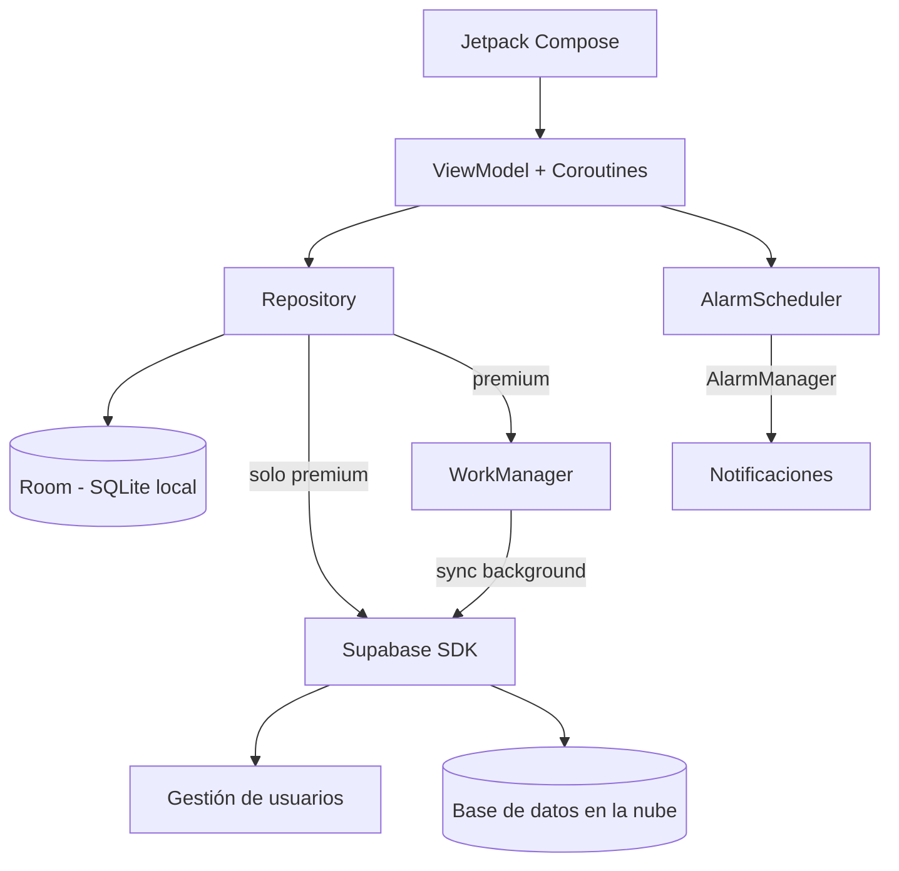
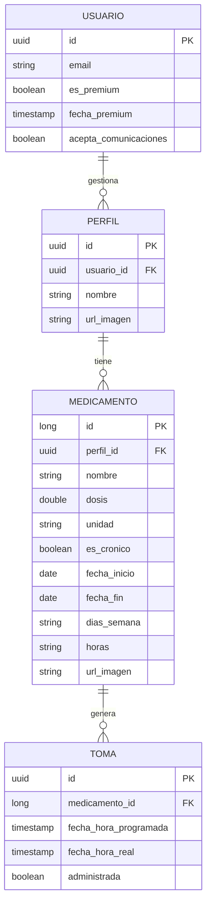

# Deseño

## Diagrama da arquitectura

## Diagrama de Base de Datos

## Deseño de interface de usuarios
[Enlace al diseño de Figma](https://www.figma.com/design/7y2djfr8ghHQxxFoeNE2IY/PilRemind?node-id=0-1&t=AqZHzNxyVJfyXzod-1)