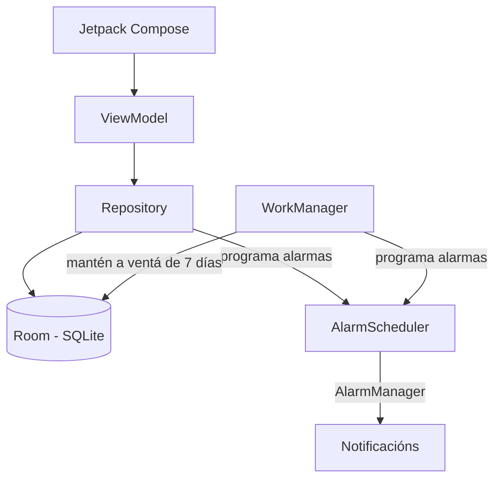
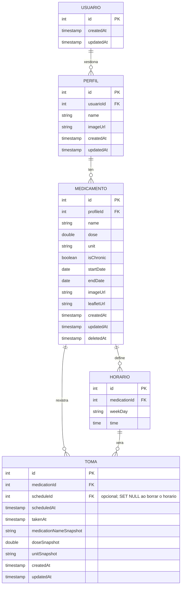

# Deseño

## Diagrama da arquitectura

> A versión con Supabase consérvase unicamente nas ramas históricas. A rama actual é local-only: todos os datos se gardan en Room no dispositivo.

## Diagrama de Base de Datos de Room

- Un medicamento pode ter varios horarios e varias tomas.
- Un horario pode xerar varias tomas ao longo do tempo.
- Cada toma pertence a un medicamento e pode apuntar a un horario ou quedar sen el.
- `medicationNameSnapshot`, `doseSnapshot` e `unitSnapshot` conservan os datos do medicamento no momento de crear a toma.
- `deletedAt` permite arquivar un medicamento sen borrar o seu historial.
- As columnas de clave foránea (`usuarioId`, `profileId`, `medicationId`) teñen índices para acelerar as relacións e os borrados en cascada.

## Deseño de interface de usuarios
[Enlace al diseño de Figma](https://www.figma.com/design/7y2djfr8ghHQxxFoeNE2IY/PilRemind?node-id=0-1&t=AqZHzNxyVJfyXzod-1)
